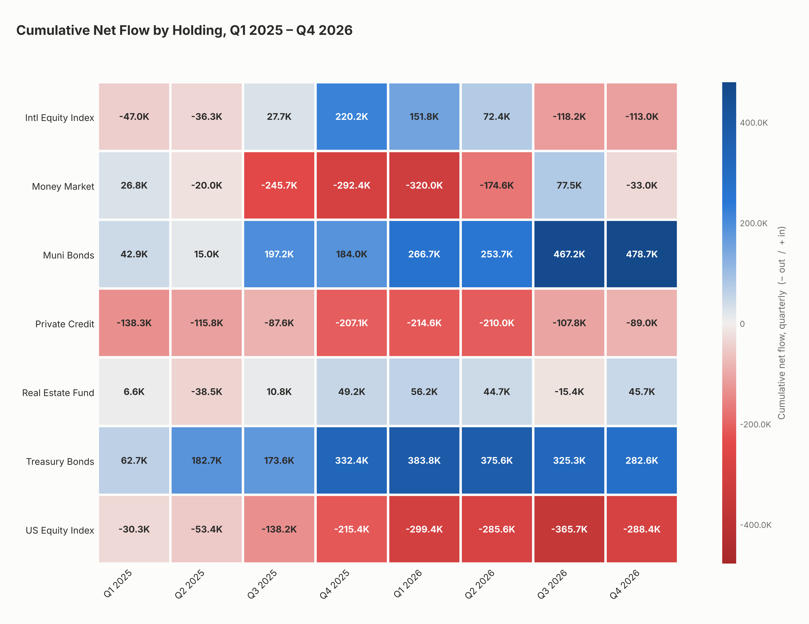

# Cash flow heat map

Builds a "Sources and Uses" heat map of quarterly (or monthly) net cash flows per account from
an Excel file, sized to print on US Letter paper in landscape (11 × 8.5 in, 300 dpi PNG).


## Input

An `.xlsx` file whose first sheet has a header row with these columns:

| Column | Meaning |
|---|---|
| `Date` | Date of the flow. Dates may repeat. |
| `Amount` | Amount moved. Numbers or text such as `"1,234.56"`, `"$1,500"` or `"(250.00)"`. |
| `To` | Account receiving the money (+Amount). |
| `From` | Account sending the money (−Amount). |

Other columns, such as `To Holding` and `From Holding`, may be included and are ignored.
Columns can be in any order.

Rows with an unreadable date or amount are skipped, and the script lists them.

## Usage

```bash
pip install -r requirements.txt
python cashflow_heatmap.py flows.xlsx -o heatmap.png
```

Options:

- `--period quarterly|monthly` sums the flows per calendar quarter (the default) or month.
- `--sheet NAME` reads a sheet other than the first.
- `--no-labels` leaves the numbers out of the cells.

## What the chart shows

- One row per account, in the order **Estate, Illiquid, Semi-liquid, Liquid, Safe**
  (`ACCOUNT_ORDER`). Estate is hidden if it never appears in the file (`HIDE_IF_UNUSED`).
  Any other account name is shown at the bottom with a warning.
- One column per calendar quarter (or month with `--period monthly`), plus a
  **Total** column for the whole period.
- Blue is net money in, red is net money out, gray is zero. The numbers are in bold.
- If an account named **Net Outflow** appears in the `To` column, it is shown in a
  separate row along the bottom with its sign reversed.
- The Total column and the Net Outflow row each have their own color scale; the
  legend applies to the quarterly (or monthly) cells of the main grid.

`example/` contains a made-up input file and the heat map it produces.

## Cumulative net flow by holding

`holding_heatmap.py` builds a second heat map: the running total of net flow into each
holding, by calendar quarter (or month). It uses the same colors, page size and bold cell
labels as `cashflow_heatmap.py`. By default it uses only the most recent quarter in the file;
`--all-data` uses every row.



The input sheet needs these columns, in any order. Any other columns, such as `To` and
`From`, are ignored.

| Column | Meaning |
|---|---|
| `Date` | Date of the flow. Dates may repeat. |
| `Amount` | Amount moved, in the same formats as above. |
| `To Holding` | Holding receiving the money (+Amount). |
| `From Holding` | Holding sending the money (−Amount). |

```bash
python holding_heatmap.py flows.xlsx -o holding_heatmap.png                    # latest quarter
python holding_heatmap.py flows.xlsx --period monthly -o latest_by_month.png  # its 3 months
python holding_heatmap.py flows.xlsx --all-data -o all_quarters.png           # every quarter
```

`--sheet` and `--no-labels` work as above.

- **Latest quarter (default):** only rows dated in the most recent calendar quarter that
  appears in the file are used, so the running totals start at zero at the beginning of
  that quarter. The quarter is shown in the title and printed when the script runs.
- **`--all-data`:** every row is used, and the title shows the range of quarters.
- Each cell is the holding's net flow (in minus out) added up from the first period shown
  through the end of that period. Periods with no activity carry the total forward.
- A blank `To Holding` or `From Holding` (e.g. an external deposit or withdrawal) only
  affects the other side.
- Holdings are listed alphabetically.
- If the numbers don't fit in the cells (e.g. many months), they're rounded to whole
  thousands or millions (`-366K`) instead of one decimal place.

`example/sample_holding_flows.xlsx` is a made-up input file for this script.
