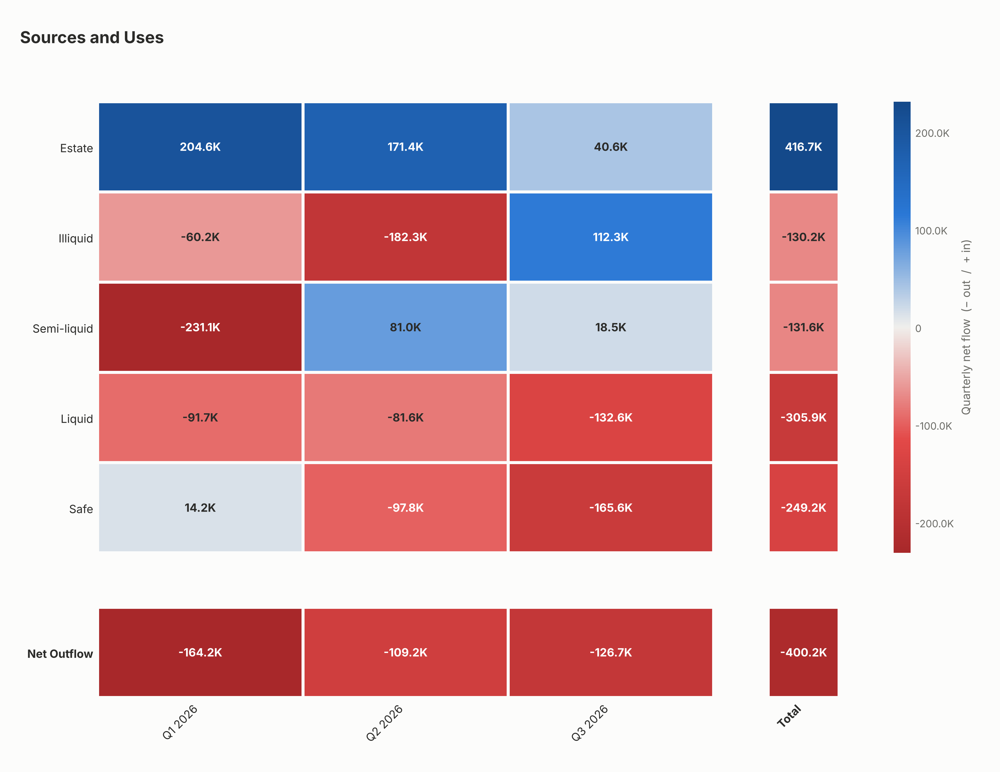

# Cash flow heat map

Builds a "Sources and Uses" heat map of quarterly (or monthly) net cash flows per account from
an Excel file, sized to print on US Letter paper in landscape (11 × 8.5 in, 300 dpi PNG).



## Input

An `.xlsx` file whose first sheet has a header row with these columns:

| Column | Meaning |
|---|---|
| `Date` | Date of the flow. Dates may repeat. |
| `Amount` | Amount moved. Numbers or text such as `"1,234.56"`, `"$1,500"` or `"(250.00)"`. |
| `To` | Account receiving the money (+Amount). |
| `From` | Account sending the money (−Amount). |

Rows with an unreadable date or amount are skipped, and the script lists them.

## Usage

```bash
pip install -r requirements.txt
python cashflow_heatmap.py flows.xlsx -o heatmap.png
```

Options:

- `--period quarterly|monthly` sums the flows per calendar quarter (the default) or month.
- `--sheet NAME` reads a sheet other than the first.
- `--no-labels` leaves the numbers out of the cells.

## What the chart shows

- One row per account, in the order **Estate, Illiquid, Semi-liquid, Liquid, Safe**
  (`ACCOUNT_ORDER`). Estate is hidden if it never appears in the file (`HIDE_IF_UNUSED`).
  Any other account name is shown at the bottom with a warning.
- One column per calendar quarter (or month with `--period monthly`), plus a
  **Total** column for the whole period.
- Blue is net money in, red is net money out, gray is zero. The numbers are in bold.
- If an account named **Net Outflow** appears in the `To` column, it is shown in a
  separate row along the bottom with its sign reversed.
- The Total column and the Net Outflow row each have their own color scale; the
  legend applies to the quarterly (or monthly) cells of the main grid.

`example/` contains a made-up input file and the heat map it produces.
